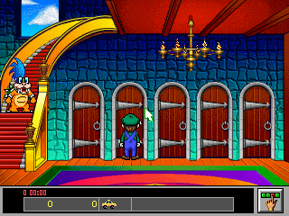

# Mario Is Missing! CD-ROM Deluxe (DOS): Static Recompilation


## What it is

A static recompilation of **Mario Is Missing! CD-ROM Deluxe** (The Software
Toolworks, 1993) from its shipping DOS executable to C, built as a native
Windows program. No DOSBox, no emulator.

`MARIO.BIN` is the game behind the CD's small `MARIO.EXE` launcher. Its 1,936
functions, including the 197 KB of code in its 40 Borland VROOMM overlays, are
lifted to C by [pcrecomp](https://github.com/sp00nznet/pcrecomp), compiled
with MSVC, and run against a small model of a 1993 PC (DOS, VGA, EMS, mouse)
in `src/`. The game's own code does everything else.

Built on the [pcrecomp](https://github.com/sp00nznet/pcrecomp) toolchain and
following its shared house style (layout, CLI, conformance harness, headless
mode), like the other recomps there. The runtime and lifter came from the
[Blake Stone](https://github.com/sp00nznet/blakestone) and
[Corridor 7](https://github.com/sp00nznet/corridor7) recomps.

The SNES version is a separate project:
[sp00nznet/marioismissing](https://github.com/sp00nznet/marioismissing).

**Generated source is not distributed.** You supply your own copy of the game,
and the lifted C is generated on your machine into `work/` (gitignored).
Nothing from the game is in this repository.

## Status: **v0.1.0, early alpha. Boots to Bowser's castle; you can walk into the first city.**

| Area | State |
|---|---|
| Version recompiled | `MARIO.BIN`, CD-ROM Deluxe (USA), Aug 1993 |
| Lift (`tools/lift.py mim`) | 1,936 functions (40 VROOMM overlays made resident), 107,256 instructions; 11 instruction forms not handled yet |
| Castle, Koopaling dialogue, the cursor | ✅ |
| Mouse (absolute pointer, the game's event handler) | ✅ |
| Choosing a door, the pipe, arriving in a city | ✅ |
| City streets, map, phone, computer | first screen seen, not played |
| Sound and music (DIGPAK/MIDPAK) | ❌ the game runs its own silent path |
| Videos (`VIDEO/`) | untested |
| Saving and loading | untested |
| A full city, a full playthrough | not yet |
| Linux, macOS | not yet (an SDL2 host is in `src/host.c`, untested; its mouse is still the old relative one) |
| Headless mode | `--headless` with `--seconds`, `--keys`, `--shot-at`; `--record out.mp4` pipes to ffmpeg |
| Self-test (`selftest.exe`, no game data) | **3/3 pass**: the VGA, x87 and Sound Blaster/AdLib models |
| Conformance harness against the game | not yet ([ROADMAP](ROADMAP.md)) |
| `Setup.cmd` | ✅ tested from a clean clone: lifts, builds, self-test passes, shortcut made |
| Installer (recomp-launcher) | `launcher/launcher.json` and a manual-run workflow; no installer has been built yet |

## Screenshots

Real output of the recompiled game:

| | |
|---|---|
|  |  |
| Luigi at a door | Through the pipe |
|  | |
| The first city | |

## Getting Started

You need **your own copy of the Mario Is Missing! CD-ROM Deluxe disc** (or a
mounted image of it, or a copy of its `MARIO` folder) and about 1 GB free.
Nothing is downloaded for you.

### Quick start: Setup.cmd

1. Download this repository (the green **Code** button, then **Download ZIP**)
   and unzip it.
2. Put the disc in (or mount its image).
3. Double-click **`Setup.cmd`**.

It checks for Python 3, CMake, Git and the Visual Studio 2022 C++ build tools,
and **asks** before installing any of them with winget, saying what and how
big. It finds `MARIO\MARIO.BIN` on any drive, or asks where it is
(`Setup.cmd -GameDir E:\` skips the question, `-Yes` answers yes to every
install). Then it copies the `MARIO` folder into `original\mim`, clones
pcrecomp beside this folder at the tested commit, lifts `MARIO.BIN`, builds,
runs the self-test, and leaves a **`Mario Is Missing`** shortcut in this
folder. A rerun skips finished steps (`-Force` redoes the lift). If it stops,
it says why in one sentence, and the details are in `setup.log`.

### Step by step

Prerequisites: Windows 10/11, Python 3.10+ (`py --version`), CMake 3.20+,
Git, and Visual Studio 2022 (or its Build Tools) with *Desktop development
with C++*. ffmpeg on `PATH` only for `--record`.

1. **The toolkit**, beside this folder, at the commit this game was tested with:
   ```
   git clone https://github.com/sp00nznet/pcrecomp ..\pcrecomp
   git -C ..\pcrecomp checkout ef3f0da
   set PCRECOMP_HOME=%CD%\..\pcrecomp
   ```
   Without `PCRECOMP_HOME`, `tools\lift.py` and CMake look for `..\pcrecomp`.
2. **Your game files**: copy the CD's `MARIO` folder, all of it, into
   `original\mim\` (so that `original\mim\MARIO.BIN` exists).
3. **Lift** (about 15 seconds):
   ```
   > py tools\lift.py mim
     overlays: 40 placed resident, 197220 bytes, 688 entries
   MARIO.BIN: DGROUP 1D77, 135 code segments, 1936 functions, 107256 instructions lifted, 860 stored code pointers, 24 extra entries, 44 switch tables
     6 undecodable targets, first: 1B5B:FFFF (in fn_1B5D0), ...
     renderer: 0 raycaster candidates, hi-res off
     107 self-modified code bytes
     unhandled instruction forms: 11 (4 kinds), ...
     -> ...\work\mim\gen (13 files, ...)
   ```
   `tools\mim_seeds.txt` lists the entry points earlier runs found only at run
   time; without them a fresh lift has 1,887 functions and the game stops at a
   garbled screen.
4. **Build** (a few minutes):
   ```
   cmake -B build -A Win32 -DPCRECOMP_HOME=%PCRECOMP_HOME%
   cmake --build build --config Release -- -m
   build\Release\selftest.exe
   ```
   Expected: `build\Release\marioismissing.exe`, and `selftest: all passed`.
5. **Play**, from this folder (it reads `original\mim` and keeps CONFIG and
   saved games in `saves\mim`):
   ```
   build\Release\marioismissing.exe
   ```
   It is played with the mouse.

The usual trip-ups: `python` opening the Microsoft Store (that is Windows'
alias placeholder; use `py`, or turn the alias off in *Settings > Apps >
Advanced app settings > App execution aliases*); a freshly installed tool not
being on `PATH` until you open a new window; and a `..\pcrecomp` on a branch
other than the tested commit (it may lift differently).

## Usage

```
build\Release\marioismissing.exe                                   # play, in a window
build\Release\marioismissing.exe --fullscreen --display crt         # fullscreen, CRT look (F11 cycles)
build\Release\marioismissing.exe --headless --seconds 40 --shot-at "35000:C:\tmp\castle.bmp"
build\Release\marioismissing.exe --headless --keys "4000:ENTER,6000:CLICK@160;100" --record run.mp4
build\Release\selftest.exe                                          # the hardware models, no game data
```

| Flag | |
|---|---|
| `--data DIR`, `--save DIR` | the game's files (default `original\mim`), CONFIG and saved games (default `saves\mim`) |
| `--headless` | no window, no audio device; time is deterministic |
| `--realtime` | headless, but on the wall clock |
| `--record OUT.mp4` | video and audio through ffmpeg |
| `--seconds N` | quit after N seconds of emulated time |
| `--keys LIST` | scripted input, `ms:KEY[+holdms],...`; `ms:CLICK@x;y` clicks the mouse |
| `--shot FILE.bmp`, `--shot-at "ms:file.bmp,..."` | the last frame at exit, or frames at emulated times |
| `--wav OUT.wav` | write the audio |
| `--mute`, `--scale N`, `--fullscreen`, `--display sharp\|pixel\|crt` | sound off, window size, fullscreen (Alt+Enter toggles), display mode |
| `--trace` | log DOS calls to stderr |

The full list is at the top of [`src/main.c`](src/main.c).

## Building from source

Steps 1 to 4 above; `Setup.cmd` runs the same commands. How the pieces fit is
[docs/architecture.md](docs/architecture.md) (the pipeline and the machine
model, from Blake Stone); what this game needed (Borland overlays, the 8087
emulator's segment overrides, the mouse, its sound drivers) is
[docs/lifting.md](docs/lifting.md). The selftest builds without any game
data, so it builds and runs on its own.

## Credits

The runtime and lifter came from the [Corridor 7 recomp](https://github.com/sp00nznet/corridor7)
and, before it, the [Blake Stone recomp](https://github.com/sp00nznet/blakestone).
[ymfm](https://github.com/aaronsgiles/ymfm) (BSD-3-Clause). See [NOTICE](NOTICE).

## License

MIT for the code in this repository; see [LICENSE](LICENSE), and
[NOTICE](NOTICE) for the third-party code. Mario Is Missing! is commercial
software and is not included; Mario and Luigi are Nintendo's.
