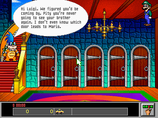
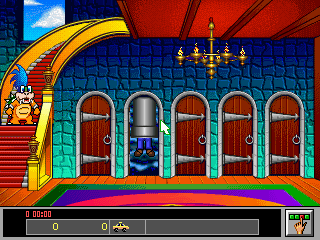
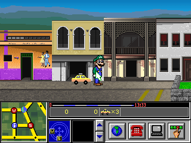

# Mario Is Missing! CD-ROM Deluxe (DOS) — Static Recompilation

Static recompilation of **Mario Is Missing! CD-ROM Deluxe** (The Software
Toolworks, 1993) from its shipping DOS executable, `MARIO.BIN`, to C, built as
a native Windows program. Its 1,936 functions, including the 197 KB of code in
its 40 Borland VROOMM overlays, are lifted to C, compiled with MSVC, and run
against a small model of a 1993 PC (DOS, VGA, EMS, mouse). The game's own code
does everything else. No DOSBox, no emulator.

Built on the [pcrecomp](https://github.com/sp00nznet/pcrecomp) toolchain; the
runtime and lifter came from the [Corridor 7](https://github.com/sp00nznet/corridor7)
and [Blake Stone](https://github.com/sp00nznet/blakestone) recomps. The SNES
version is a separate project,
[sp00nznet/marioismissing](https://github.com/sp00nznet/marioismissing).

## Getting Started

You need **your own copy of the Mario Is Missing! CD-ROM Deluxe disc** (or a
mounted image of it, or a copy of its `MARIO` folder) and about 1 GB free.
Nothing from the game is in this repository or downloaded for you; everything
is built on your machine from your copy.

### The setup scripts

1. Download this repository (the green **Code** button, then **Download ZIP**)
   and unzip it.
2. Put the disc in (or mount its image), and double-click **`Setup.cmd`**.
3. Play with the **`Mario Is Missing`** shortcut in that folder. It is played
   with the mouse.

The script checks for Python 3, CMake, Git and the Visual Studio 2022 C++
build tools and **asks** before installing any of them, finds `MARIO\MARIO.BIN`
on any drive (or asks; `-GameDir E:\` skips the question, `-Yes` answers yes
to every install), copies the game into `original\mim`, fetches pcrecomp
(`main`, pinned at the tested commit `ef3f0da`) beside this folder, lifts,
builds and runs the self-test. A rerun skips finished steps; if it stops, it
says why, with the details in `setup.log`. Building by hand and the command
line are in **[docs/building.md](docs/building.md)**. Windows only for now:
`setup.sh` says so and exits.

## Status

**v0.1.0, early alpha.** It boots to Bowser's castle, and you can walk into the first city.

| Area | State |
|---|---|
| Version recompiled | `MARIO.BIN`, CD-ROM Deluxe (USA), Aug 1993 |
| Lift (`tools/lift.py mim`) | 1,936 functions (40 VROOMM overlays made resident), 107,256 instructions; 11 instruction forms not handled yet |
| Castle, Koopaling dialogue, the cursor | ✅ |
| Mouse (absolute pointer, the game's event handler) | ✅ |
| Choosing a door, the pipe, arriving in a city | ✅ |
| City streets, map, phone, computer | first screen seen, not played |
| Sound and music (DIGPAK/MIDPAK) | ❌ the game runs its own silent path |
| Videos (`VIDEO/`) | untested |
| Saving and loading | untested |
| A full city, a full playthrough | not yet |
| Linux, macOS | not yet (an SDL2 host is in `src/host.c`, untested; its mouse is still the old relative one) |
| Headless mode | `--headless` with `--seconds`, `--keys`, `--shot-at`; `--record out.mp4` pipes to ffmpeg |
| Self-test (`selftest.exe`, no game data) | **3/3 pass**: the VGA, x87 and Sound Blaster/AdLib models |
| Conformance harness against the game | not yet ([ROADMAP](ROADMAP.md)) |
| `Setup.cmd` | ✅ tested from a fresh clone: lifts, builds, self-test passes, shortcut made |
| Installer (recomp-launcher) | `launcher/launcher.json` and a manual-run workflow; no installer built or released yet |

## Screenshots

Real output of the recompiled game, headless (`--shot-at`):

| | |
|---|---|
|  |  |
| Luigi at a door | Through the pipe |
|  | |
| The first city | |

## Documentation

- [docs/building.md](docs/building.md): building by hand, the command line, netlab
- [docs/testing.md](docs/testing.md): the self-test and scripted headless runs
- [docs/architecture.md](docs/architecture.md): the pipeline and the machine model
- [docs/lifting.md](docs/lifting.md): what this game needed: Borland overlays, the 8087 emulator, the mouse, its sound drivers
- [ROADMAP.md](ROADMAP.md), [CHANGELOG.md](CHANGELOG.md), [CONTRIBUTING.md](CONTRIBUTING.md)

## Contributors

See **[CONTRIBUTORS.md](CONTRIBUTORS.md)** for who did what.

## License

MIT for this repository's own code ([LICENSE](LICENSE)); ymfm is BSD-3-Clause.
Mario Is Missing! is © The Software Toolworks, and Mario and Luigi are
Nintendo's; none of the game's files, and nothing generated from them, is in
this repository ([NOTICE.md](NOTICE.md)).
